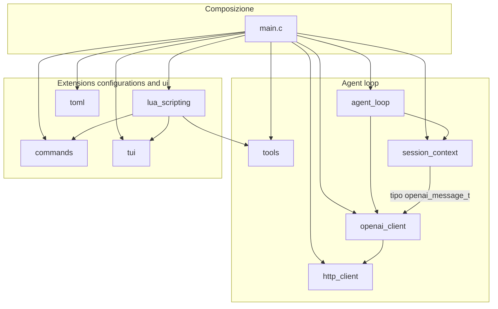

# emma-code architecture

emma-code è un agente TUI minimale per il coding, scritto in **C99** con
**Lua 5.4** (5.3 accettata) come motore di scripting. L'architettura è a
moduli ortogonali: ogni componente vive in `src/foo.c` con la sua interfaccia
pubblica in `include/foo.h`.

Il grafo seguente è ricavato dagli `#include` reali dei sorgenti.

## Architettura alto livello



## Tabella: chi include chi

| Componente | Dipende da (interno) | Dipendenze esterne |
|---|---|---|
| `main.c` | agent_loop, commands, lua_scripting, tools, tui, session_context, openai_client, toml, http_client | — |
| `agent_loop` | openai_client (tipi), session_context | — |
| `lua_scripting` | commands (registro comandi), tools (registro tool), tui (per `emma.append_message`/`set_status`) | liblua, libcjson |
| `session_context` | openai_client (solo il tipo `openai_message_t`) | — |
| `openai_client` | http_client | libcJSON, libcurl (indiretta) |
| `http_client` | — | libcurl |
| `tools` | — | libcjson |
| `system_prompt` | — | — |
| `commands` | — | — |
| `tui` | — | — |
| `toml` | — | — |

## Osservazioni architetturali

- **`main.c` è l'hub**: include tutto ed è l'unico punto che conosce
  l'intero sistema. I moduli sottostanti non si conoscono tra loro, tranne
  due eccezioni mirate:
  - `session_context → openai_client`: dipendenza *solo di tipi*
    (condivide `openai_message_t`), non di logica.
  - `lua_scripting → commands` e `lua_scripting → tui`: il ponte Lua deve
    poter registrare comandi nel registro e toccare la UI, quindi li
    referenzia direttamente.
- **`agent_loop` è il "motore puro"**: dipende solo da tipi di
  `openai_client` e `session_context`; non sa nulla di TUI, comandi, tool
  o Lua. L'esecuzione dei tool call richiesti dal modello passa dal
  callback `on_tool_call` implementato in `main.c` (lookup nel registry,
  eventuale conferma utente, esecuzione): il loop resta testabile e
  sostituibile.
- **`tools` è il registro dei tool**: built-in (`read_file`, `write_file`,
  `bash`) e tool Lua (`emma.register_tool`) vivono nello
  stesso registry; la serializzazione per il payload OpenAI avviene in
  `tools_build_json()` e viene passata a `openai_client` come stringa JSON
  (nessuna dipendenza inversa).
- **`main.c` possiede il ciclo TUI** (init del terminale, lettura input,
  rendering di messaggi/status/delta) ma **non ne contiene la logica**:
  chiama le funzioni di `tui.[ch]`. È `main` che registra la callback
  `on_delta` e la fa atterrare nel rendering, coerente col principio
  documentato in `agent_loop.h`: "command dispatch and rendering stay in
  main.c".
- **Lo strato più basso è `http_client`**: zero dipendenze interne, solo
  libcurl. Sopra di lui `openai_client` aggiunge la semantica Chat
  Completion (JSON via cJSON, streaming SSE).
- **Il messaggio `system` iniziale** è composto da `main.c` con
  `system_prompt_full()`: il prompt statico (`system_prompt()`), più il
  blocco ambiente (OS via `uname`, directory corrente, data/ora locale)
  e le istruzioni di progetto lette una sola volta da `./AGENTS.md`
  quando presente (troncate a 64 KiB con warning), tutto interno a
  `system_prompt.c`, calcolato una sola volta all'avvio e stabile per
  tutta la sessione (cache-friendly, mai evictato dalla troncatura).
- **Nessun ciclo**: il grafo è un DAG; le uniche dipendenze "laterali"
  (`lua_scripting → commands/tui`) vanno dal modulo di scripting verso
  moduli foglia, senza creare anelli.

## Flusso di un messaggio

```
input utente → main.c → tui (rendering)
                     → commands (se "/...")
                     → lua_scripting (hook pre_message/post_message)
                     → agent_loop → openai_client → http_client
                     |            ↘ tool_calls? → on_tool_call (main.c)
                     |                             → tools (registry,
                     |                               conferma, handler)
                     |            ↘ risultati tool → prossimo round
                     ↘ session_context (storia)
```
